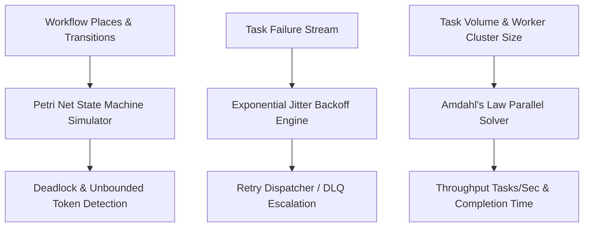

# genpark-wukong-workflow-automator


GenPark Wukong Workflow Automator is an autonomous task orchestration and resilience engine implementing discrete Petri net reachability and deadlock validation, decorrelated exponential backoff Dead-Letter Queue (DLQ) routing, and Amdahl's Law parallel cluster throughput forecasting.



## Features
- **Petri Net Deadlock Validator**: Simulates token transitions across bipartite graphs to ensure zero pipeline deadlocks.
- **Decorrelated Backoff DLQ Router**: Automatically calculates exponential delay intervals and routes exhausted jobs to dead-letter queues.
- **Amdahl Throughput Forecaster**: Models parallel cluster efficiency and tasks-per-second scaling bounds.

## MCP Runtime Requirements

Use Python 3.10+ for the MCP server. The core `client.py` has no external dependencies; MCP transport requires `mcp>=1.0.0,<2`. From this checkout, install it into the Python environment used by your MCP client:

```bash
python -m pip install -r requirements.txt
```

Use the same Python interpreter to launch `mcp_server.py`. In desktop client configuration, set `command` to that interpreter's absolute path.

## Quickstart

```python
from client import GenParkWukongWorkflowAutomator

automator = GenParkWukongWorkflowAutomator()
res = automator.forecast_workflow_throughput_amdahl(10000, serial_fraction=0.10, worker_nodes=8)
print("Projected Throughput:", res["projected_throughput_tasks_per_sec"], "tasks/sec")
```

## Local MCP Server

After installing the MCP requirements, launch the local STDIO server:

```bash
python mcp_server.py
```

Point your MCP client at the absolute path to `mcp_server.py` using the same Python interpreter. This repository does not provide a hosted MCP endpoint.

## License
MIT
