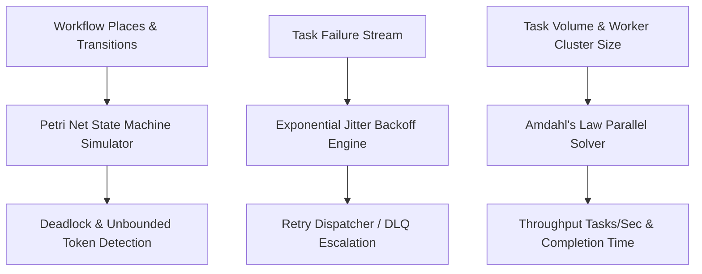

# genpark-wukong-workflow-automator


GenPark Wukong Workflow Automator is a zero-dependency autonomous task orchestration and resilience engine implementing discrete Petri net reachability and deadlock validation, decorrelated exponential backoff Dead-Letter Queue (DLQ) routing, and Amdahl's Law parallel cluster throughput forecasting.



## Features
- **Petri Net Deadlock Validator**: Simulates token transitions across bipartite graphs to ensure zero pipeline deadlocks.
- **Decorrelated Backoff DLQ Router**: Automatically calculates exponential delay intervals and routes exhausted jobs to dead-letter queues.
- **Amdahl Throughput Forecaster**: Models parallel cluster efficiency and tasks-per-second scaling bounds.

## Quickstart

```python
from client import GenParkWukongWorkflowAutomator

automator = GenParkWukongWorkflowAutomator()
res = automator.forecast_workflow_throughput_amdahl(10000, serial_fraction=0.10, worker_nodes=8)
print("Projected Throughput:", res["projected_throughput_tasks_per_sec"], "tasks/sec")
```

## License
MIT
